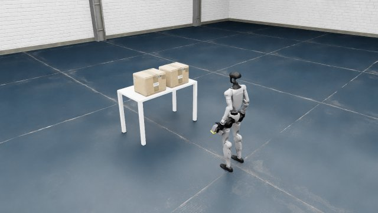
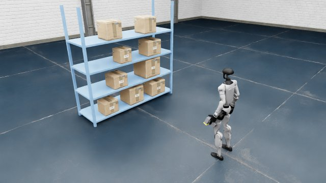
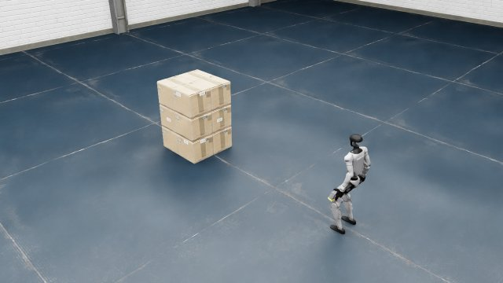

# g1_barcode_sim：G1 人形机器人仓库扫码仿真环境

中文 | English（即将提供）

基于 Isaac Sim 5.1 / Isaac Lab 的仿真环境：Unitree G1 人形机器人左手夹持一把手持扫码枪，在仓库里寻找纸箱（桌面、货架、地面箱堆）上的条码标签，走过去、对准并扫码。环境提供头部 RGB-D 相机、枪头相机、全身行走控制、手臂 IK、基于图像解码的扫码判定和完整的 ground truth，以及可复现的测试场景集（task suites）。

| 桌面场景 | 货架场景 | 地面箱堆（四面贴码） |
|:---:|:---:|:---:|
|  |  |  |

<sub>均为机器人左后方视角。</sub>

**详细文档**（环境配置、实现细节、每个场景和 task suite 的说明）见 [`docs/`](docs/) 目录（Sphinx 文档源文件）。

## 主要内容

| 模块 | 说明 |
|---|---|
| 机器人 | Unitree G1（29 自由度全身）+ Dex1 二指夹爪，左手固定夹持扫码枪，右手夹爪可开合 |
| 全身控制 | 默认 NVIDIA GR00T Decoupled WBC（Balance / Walk 两个 ONNX 策略，控制腿和腰，支持下蹲高度命令）；可切换为 unitree 上游行走策略 |
| 手臂 | 基于 IK 的手腕位置 / 扫码枪瞄准控制（`aim_scanner`、`aim_scanner_at`） |
| 相机 | 头部 RGB-D 相机；扫码枪枪头相机；离机辅助相机（俯视、斜视角渲染） |
| 扫码 | 扣扳机时对枪头相机画面做条码解码（pyzbar），返回离画面中心最近的码；另给出射线几何的 GT 诊断 |
| 条码 | Code128 / QR，程序生成并逐张解码校验；带白底标签，可贴在箱子任意外露侧面，一个面可贴多个 |
| 场景 | 3 个内置场景（桌面 / 货架 / 箱堆）+ 测试场景集：桌面场景（t1_*、t2_*）与箱堆场景（stack*） |

## 环境要求

- 一台满足 Isaac Sim 5.1 官方硬件要求、带 NVIDIA GPU 的 Linux 机器（单个场景约占 5 GB 显存）
- conda、git、git-lfs、C/C++ 编译工具链、cmake
- 默认场景从 NVIDIA 在线资产库加载仓库背景和纸箱模型，需要能访问该资产库（离线时可改用几何体，见详细文档）

## 安装（概要）

完整步骤、版本表和常见问题见 [详细文档 · 环境配置](docs/index.html#install)。

```bash
# 1) Python 3.11 环境
conda create -y -n g1sim python=3.11 && conda activate g1sim

# 2) Isaac Sim 5.1.0 与 Isaac Lab（固定 commit，按各自官方文档安装）
pip install "isaacsim[all,extscache]==5.1.0" --extra-index-url https://pypi.nvidia.com
git clone https://github.com/isaac-sim/IsaacLab.git
cd IsaacLab && git checkout 80094be3245aa5c8376a7464d29cb4412ea518f5 && ./isaaclab.sh --install && cd ..

# 3) CycloneDDS 0.10.x + unitree_sdk2_python、unitree_sim_isaaclab（固定 commit，并下载其 USD 资产）
#    —— 详见文档；unitree_sim_isaaclab 默认放在本仓库旁边（../unitree_sim_isaaclab），
#    或用环境变量 UNITREE_SIM_ROOT 指定其路径
git clone https://github.com/unitreerobotics/unitree_sim_isaaclab.git
cd unitree_sim_isaaclab && git checkout e30c25b1dffdf92ada1d6c8c1fe9a47bdde0fecc \
  && pip install -r requirements.txt && bash fetch_assets.sh && cd ..

# 4) 本仓库的额外依赖（pyzbar 需要 zbar 共享库）
conda install -y -c conda-forge zbar
pip install python-barcode==0.16.1 qrcode==7.4.2 pyzbar==0.1.9 pillow opencv-python pyyaml scipy imageio-ffmpeg pytest

# 5) 本仓库
git clone <本仓库地址> g1_barcode_sim && cd g1_barcode_sim
export OMNI_KIT_ACCEPT_EULA=YES
# export UNITREE_SIM_ROOT=/path/to/unitree_sim_isaaclab   # 不在 ../unitree_sim_isaaclab 时
```

## 快速开始

```bash
python -m pytest tests/                          # CPU 单元测试（不需要 Isaac Sim）
python scripts/generate_barcodes.py              # 生成并校验条码贴图（env 首次启动时也会自动生成）
python scripts/run_scene.py --scene s1_table     # 打开内置场景并用键盘控制（s1_table | s2_shelf | s3_stack）
python scripts/check_env.py                      # 全面自检（站立、行走、夹爪、相机、扫码），结果写到 outputs/
python scripts/testsuite/list.py                 # 列出所有测试场景集
python scripts/testsuite/preview.py --suite stack4c_L0 --oblique   # 渲染某个 suite 的预览图
```

Python 中加载一个测试场景、扫码：

```python
from g1_barcode_sim.env import G1BarcodeEnv

env = G1BarcodeEnv("scenario", headless=True, seed=0)   # 测试场景模式
obs = env.reset(scenario="t2_L0_0000")                  # 场景 id、JSON 路径或 dict
print(obs["rgb"].shape, obs["depth"].shape)             # 头部相机 RGB-D

gt = env.get_ground_truth()                              # 仅供评测：箱子、条码位姿等
r = env.move_relative(0.5, 0.0, 0.0)                     # 基于里程计的相对移动 (dx, dy, dyaw)
print(r["status"])
res = env.scan()                                         # 扣扳机：解码枪头相机画面
print(res["status"], res["content"])
env.close()
```

更多 API（行走、下蹲、手腕 / 扫码枪瞄准、夹爪、辅助相机渲染）见 [详细文档 · Python API](docs/index.html#api)。

## 场景

| 类型 | 名称 | 说明 |
|---|---|---|
| 内置场景 | `s1_table`、`s2_shelf`、`s3_stack` | 桌面、货架、地面箱堆，用 `G1BarcodeEnv("<name>")` 打开 |
| 桌面 suite | `t1_L0`、`t1_L1_*`、`t1_L2`，`t2_L0`、`t2_L1_*`、`t2_L2` | 桌上两个箱子；L0 标称、L1 单因素变化、L2 多因素随机 |
| 箱堆 suite | `stack3_L0`、`stack9_L0`、`stack9p_L0`、`stack9c_L0`、`stack4f_L0`、`stack4c_L0` | 地面箱堆：单面 / 四面贴码，多种纸箱外观 |

每个场景的图片和使用方法见 [详细文档 · 场景](docs/index.html#scenes) 与 [Task suites](docs/index.html#suites)。task suite 会持续更新。

## 目录结构

```
g1_barcode_sim/        Python 包：env.py（G1BarcodeEnv）、行走 / 手臂 / 扫码枪 / 相机 / 场景搭建 / 测试场景
configs/               机器人、相机、扫码枪、条码、场景、测试场景因素的 YAML 配置
scripts/               运行场景、遥操作、自检、渲染、条码生成；scripts/testsuite/ 下为 suite 工具
suites/                测试场景集（每个 suite：manifest.json + scenarios/*.json）
examples/              最小示例（走到条码前、瞄准并扫码）
tests/                 CPU 单元测试
assets/gear_wbc/       GR00T WBC 策略（ONNX）及其许可证
docs/                  详细文档网页与图片
```

## 许可证与致谢

- `assets/gear_wbc/` 中的 GR00T WholeBodyControl 策略权重来自 [NVlabs/GR00T-WholeBodyControl](https://github.com/NVlabs/GR00T-WholeBodyControl)，遵循 NVIDIA Open Model License（见该目录下的 `NOTICE` 与许可证全文）。
- 机器人模型与上游行走策略来自 [unitree_sim_isaaclab](https://github.com/unitreerobotics/unitree_sim_isaaclab)（Apache-2.0），不随本仓库分发。
- 仓库背景与纸箱模型来自 NVIDIA Isaac Sim 资产库，运行时在线引用。
- 本仓库代码：MIT License（见 [`LICENSE`](LICENSE)）；第三方组件遵循各自的许可证（见上）。
