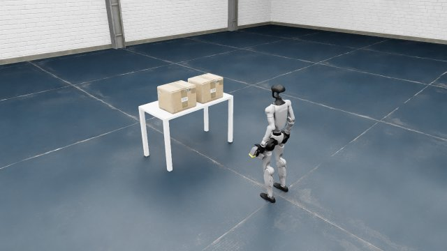
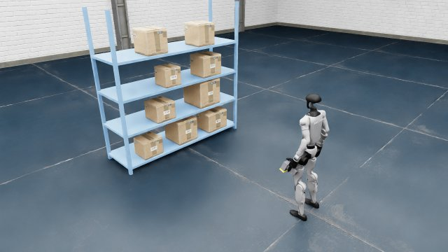
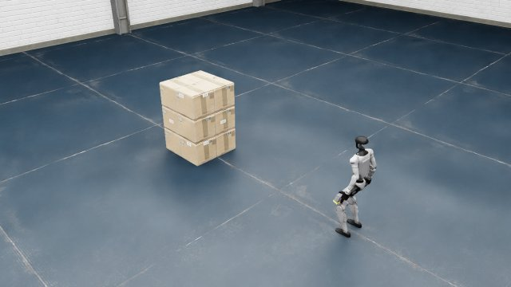

# g1_barcode_sim: Warehouse Barcode-Scanning Simulation for the G1 Humanoid

[中文](README.md) | English

A simulation environment built on Isaac Sim 5.1 / Isaac Lab: a Unitree G1 humanoid holds a handheld barcode scanner in its left hand, searches a warehouse for barcode labels on cardboard boxes (on tables, on shelves, in stacks on the floor), walks up to them, aims and scans. The environment provides a head RGB-D camera, a scanner camera, whole-body locomotion control, arm IK, scan evaluation based on image decoding, complete ground truth, and reproducible test scenario sets (task suites).

| Table scene | Shelf scene | Floor stack (labels on four faces) |
|:---:|:---:|:---:|
|  |  |  |

<sub>All views are from behind the robot's left shoulder.</sub>

**Documentation** (installation, implementation details, every scene and task suite): <https://yuxuanli224284.github.io/g1_docs/barcode_sim/en/> (sources in [`docs/en/`](docs/en/), Sphinx).

## Features

| Component | Description |
|---|---|
| Robot | Unitree G1 (29-DoF whole body) + Dex1 two-finger grippers; the left hand permanently holds the scanner, the right gripper can open and close |
| Whole-body control | NVIDIA GR00T Decoupled WBC by default (two ONNX policies, Balance / Walk, controlling the legs and waist, with a squat height command); the upstream unitree locomotion policy is available as an alternative |
| Arms | IK-based wrist position and scanner aiming control (`aim_scanner`, `aim_scanner_at`) |
| Cameras | Head RGB-D camera; scanner camera at the scanner head; off-robot auxiliary cameras (top-down and oblique renders) |
| Scanning | Pulling the trigger decodes the scanner camera image (pyzbar) and returns the code closest to the image center; a GT diagnostic based on ray geometry is also provided |
| Barcodes | Code128 / QR, generated procedurally and verified by decoding each one; labels with a white backing can be placed on any exposed side face of a box, several per face |
| Scenes | 3 built-in scenes (table / shelf / box stack) + task suites: table scenarios (t1_*, t2_*) and stack scenarios (stack*) |

## Requirements

- A Linux machine with an NVIDIA GPU that meets the official Isaac Sim 5.1 hardware requirements (a single scene uses about 5 GB of GPU memory)
- conda, git, git-lfs, a C/C++ toolchain, cmake
- The default scenes load the warehouse background and box models from NVIDIA's online asset library, which must be reachable (offline, geometric primitives can be used instead; see the documentation)

## Installation (summary)

Full steps, the version table and troubleshooting are in [Documentation · Installation](docs/en/installation.md).

```bash
# 1) Python 3.11 environment
conda create -y -n g1sim python=3.11 && conda activate g1sim

# 2) Isaac Sim 5.1.0 and Isaac Lab (pinned commit; follow their official docs)
pip install "isaacsim[all,extscache]==5.1.0" --extra-index-url https://pypi.nvidia.com
git clone https://github.com/isaac-sim/IsaacLab.git
cd IsaacLab && git checkout 80094be3245aa5c8376a7464d29cb4412ea518f5 && ./isaaclab.sh --install && cd ..

# 3) CycloneDDS 0.10.x + unitree_sdk2_python, unitree_sim_isaaclab (pinned commit, plus its USD assets)
#    -- see the documentation; by default unitree_sim_isaaclab sits next to this repository
#    (../unitree_sim_isaaclab), or set its path with the environment variable UNITREE_SIM_ROOT
git clone https://github.com/unitreerobotics/unitree_sim_isaaclab.git
cd unitree_sim_isaaclab && git checkout e30c25b1dffdf92ada1d6c8c1fe9a47bdde0fecc \
  && pip install -r requirements.txt && bash fetch_assets.sh && cd ..

# 4) Additional dependencies of this repository (pyzbar needs the zbar shared library)
conda install -y -c conda-forge zbar
pip install python-barcode==0.16.1 qrcode==7.4.2 pyzbar==0.1.9 pillow opencv-python pyyaml scipy imageio-ffmpeg pytest

# 5) This repository
git clone <repository URL> g1_barcode_sim && cd g1_barcode_sim
export OMNI_KIT_ACCEPT_EULA=YES
# export UNITREE_SIM_ROOT=/path/to/unitree_sim_isaaclab   # if it is not at ../unitree_sim_isaaclab
```

## Quick start

```bash
python -m pytest tests/                          # CPU unit tests (no Isaac Sim needed)
python scripts/generate_barcodes.py              # generate and verify barcode textures (also done automatically on first env start)
python scripts/run_scene.py --scene s1_table     # open a built-in scene with keyboard control (s1_table | s2_shelf | s3_stack)
python scripts/check_env.py                      # full self-check (standing, walking, gripper, cameras, scanning); results go to outputs/
python scripts/testsuite/list.py                 # list all task suites
python scripts/testsuite/preview.py --suite stack4c_L0 --oblique   # render preview images of a suite
```

Loading a task-suite scenario and scanning from Python:

```python
from g1_barcode_sim.env import G1BarcodeEnv

env = G1BarcodeEnv("scenario", headless=True, seed=0)   # task-suite mode
obs = env.reset(scenario="t2_L0_0000")                  # scenario id, JSON path or dict
print(obs["rgb"].shape, obs["depth"].shape)             # head camera RGB-D

gt = env.get_ground_truth()                              # evaluation only: box and barcode poses, etc.
r = env.move_relative(0.5, 0.0, 0.0)                     # odometry-based relative motion (dx, dy, dyaw)
print(r["status"])
res = env.scan()                                         # pull the trigger: decode the scanner camera image
print(res["status"], res["content"])
env.close()
```

More of the API (walking, squatting, wrist / scanner aiming, gripper, auxiliary camera rendering) is in [Documentation · Python API](docs/en/api.md).

## Scenes

| Type | Name | Description |
|---|---|---|
| Built-in scenes | `s1_table`, `s2_shelf`, `s3_stack` | Table, shelf, floor stack; open with `G1BarcodeEnv("<name>")` |
| Table suites | `t1_L0`, `t1_L1_*`, `t1_L2`, `t2_L0`, `t2_L1_*`, `t2_L2` | Two boxes on a table; L0 nominal, L1 single-factor variation, L2 multi-factor randomization |
| Stack suites | `stack3_L0`, `stack9_L0`, `stack9p_L0`, `stack9c_L0`, `stack4f_L0`, `stack4c_L0` | Box stacks on the floor: labels on one face / four faces, several box appearances |

Images and usage of every scene are in [Documentation · Scenes](docs/en/scenes.md) and [Task suites](docs/en/task_suites.md). The task suites will keep being updated.

## Repository layout

```
g1_barcode_sim/        Python package: env.py (G1BarcodeEnv), locomotion / arm / scanner / cameras / scene building / task suites
configs/               YAML configs for the robot, cameras, scanner, barcodes, scenes and task-suite factors
scripts/               running scenes, teleoperation, self-check, rendering, barcode generation; suite tools in scripts/testsuite/
suites/                Task suites (per suite: manifest.json + scenarios/*.json)
examples/              Minimal examples (walk up to a barcode, aim and scan)
tests/                 CPU unit tests
assets/gear_wbc/       GR00T WBC policies (ONNX) and their license
docs/                  Documentation (Sphinx + MyST Markdown, built by GitHub Actions; English in docs/en/)
```

## License and acknowledgements

- The GR00T WholeBodyControl policy weights in `assets/gear_wbc/` come from [NVlabs/GR00T-WholeBodyControl](https://github.com/NVlabs/GR00T-WholeBodyControl) and are licensed under the NVIDIA Open Model License (see `NOTICE` and the full license text in that directory).
- The robot model and the upstream locomotion policy come from [unitree_sim_isaaclab](https://github.com/unitreerobotics/unitree_sim_isaaclab) (Apache-2.0) and are not distributed with this repository.
- The warehouse background and box models come from the NVIDIA Isaac Sim asset library and are referenced online at runtime.
- Code in this repository: MIT License (see [`LICENSE`](LICENSE)); third-party components are under their own licenses (see above).
